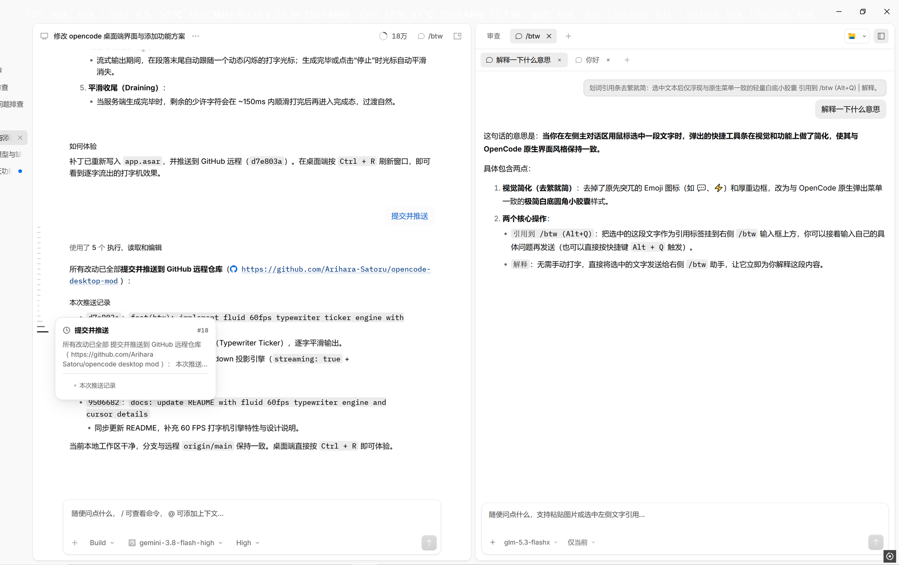
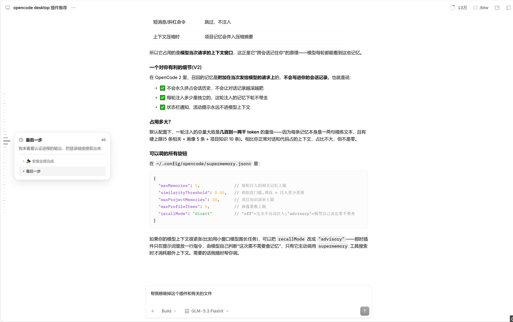
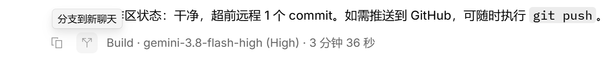

# OpenCode Desktop Timeline, /btw Companion & Branch Mod

<div align="center">

[](LICENSE)
[](https://github.com/Arihara-Satoru/opencode-desktop-mod)
[](https://nodejs.org/)
[](https://opencode.ai)

**专为 OpenCode Desktop (Electron 桌面端) 深度定制的交互体验增强套件**

[✨ 特性介绍](#-特性概览) • [🚀 快速安装](#-快速安装) • [🔄 一键还原](#-一键还原) • [🛡️ 安全透明](#️-安全与隐私承诺) • [❓ 常见问题](#-常见问题-faq)

</div>

---

> 🎯 **七大核心增强**：
> 1. **Codex 风格项目侧边栏与项目/会话双置顶**：纯正 Codex 文件夹分组与极简文字层级、项目悬浮卡片、顶部独立「已固定」分区；
> 2. **左侧极简时间轴导航条 (ChatGPT / Codex 风格悬浮游标)**：丝滑跳转任意轮次与 Markdown 小标题，解决长对话翻找痛点；
> 3. **右侧升级版 `/btw` 多轮伴侣问答面板**：支持 60 FPS 自适应打字机流式输出、独立模型切换、划词引用与多标签持久化；
> 4. **每轮回复分支到新聊天 (Codex 风格一键分支)**：助手回答底栏直出分支按钮，自动截取上下文并智能递增编号命名；
> 5. **输入框语音转文字**：发送按钮左侧新增麦克风，支持小米 MiMo ASR 和通用 OpenAI 转写接口，识别后填入草稿、不自动发送；
> 6. **对话正文自由宽度调节 (拖拽调宽 / 双击切换)**：支持左右两侧边缘隐形轨道自由拖拽、双击切换标准 / 宽屏 / 铺满，拖拽时在边缘附近显示像素提示，不占用顶栏工具区。
> 7. **长文本智能发送与折叠**：超长文字自动转为 TXT 附件，中等长度消息默认收起，点击「显示更多」查看全文。

---

<div align="center">
  
</div>

## 🌟 特性概览

```text
┌─────────────────┬──────────────────────────────────────────┬──────────────────────┐
│  左侧极简时间轴   │               主对话工作区                │   右侧 /btw 伴侣面板   │
│                 │                                          │                      │
│  — #1 提问      │  User: ...                               │  [💬 讨论 1 ×] [+]   │
│  — #2 方案      │  Assistant: ...                          │                      │
│  —   ├ 设计思路  │                                          │  > [引用第 2 轮]     │
│  —   └ 代码实现  │  [复制] [分支到新聊天]                     │  针对方案的细化答疑... │
│  — #3 优化      │  User: ...                               │  (自适应打字机输出▋) │
│                 │                                          │                      │
│  (鼠标靠近展开   │  (支持划词浮现「引用到 /btw」Alt+Q)         │  [选择模型 ▼] [仅当前]│
│   动态鱼眼与预览)│                                          │  [输入伴侣消息...]    │
└─────────────────┴──────────────────────────────────────────┴──────────────────────┘
```

### 1. 左侧会话时间轴导航条 (Timeline Scrubber)



- **极简隐形刻度尺**：借鉴 ChatGPT / Codex 悬浮时间轴，在主对话区左缘以极细水平刻线（`—`）呈现，不挤占对话宽度、不产生视觉干扰。
- **动态高斯鱼眼波浪**：鼠标掠过时刻度线呈平滑波浪展开，指引清晰自然。
- **懒加载悬浮预览卡片**：
  - 鼠标悬浮在刻度线上即时展示该轮提问序号、标题与内容摘要。
  - 自动解析该轮 AI 回答内的 Markdown `H1` / `H2` / `H3` 小标题目录并生成可点击树形跳转列表。
- **100% 丝滑减速滚动 (Cubic Ease-Out)**：
  - 针对 OpenCode 虚拟滚动列表（`@tanstack/virtual-core`）深度适配。
  - 直接提取虚拟列表底层像素偏移，彻底消除跨屏远距离跳转时原生虚拟列表强制瞬移闪烁或中途被打断的问题。
- **本地持久化索引缓存**：
  - 历史目录索引缓存至本地存储（`localStorage`），秒开秒出；支持平滑跳转任意早期历史轮次。

### 2. 右侧 `/btw` 伴侣问答面板 (Companion Chat)


官方原版 `/btw` 功能较为局限（每次问答都会强制捆绑发送当前主会话的完整历史、无法自由挑选模型、关闭即丢）。本增强补丁将其升级为完整的侧栏伴侣：
- **平滑自适应 60 FPS 打字机流式输出（Fluid Typewriter Engine）**：
  - 基于隔离的瞬态子会话（`ses_btw_*`）驱动，通过实时事件流与打字机缓冲池逐字流出。
  - 彻底消除网络包与模型分块导致的“文字一块一块弹出来”的突兀感，以人眼最舒适的匀速与自适应调速（1~3 字/帧）平滑显现。
  - 深度接入官方原生增量流式 Markdown 渲染管线，并配有动态呼吸打字光标（`▋`）。
  - 支持中途随时停止生成并完整保留已输出内容；支持失败自动重试熔断与友好报错提示。
- **多标签页对话（Native Tab Strip）**：
  - 顶部原生水平标签页设计（`[💬 标题 ×] +`），支持多话题并行提问与自由切换。
- **多模态图片输入与预览**：
  - 支持 **`Ctrl + V` 剪贴板粘贴截图**、**文件拖拽**、**左下角 `+` 按钮**添加多张图片。
  - 输入框内置图片缩略卡片，发送前/发送后均支持点击放大 Lightbox 预览。
- **独立模型自由选择**：自动加载当前可用的模型列表，可随意选择高速便宜模型（如 MiniMax / DeepSeek / Claude 等）进行辅助问答，完全独立于主会话。
- **灵活的上下文控制**：
  - ⚡ **仅引用/当前**（默认）：不携带主会话历史，杜绝 Token 浪费与干扰，专注解答当前问题。
  - 🔗 **最近 3 轮**：注入最近几轮核心交互，理解上下文背景。
  - 📚 **完整主会话**：向模型提供主会话完整记录。
- **划词一键引用 / 解释**：
  - 在主对话区任意选中文字，弹出极简悬浮胶囊：`引用到 /btw` 或 `⚡ 解释`（快捷键：`Alt+Q`）。
- **持久化连续多轮对话**：
  - 面板关闭或重启客户端不丢失对话记录，并支持一键清空重置。

### 3. 会话分支到新聊天 (Branch to New Chat)



对标 OpenAI Codex 客户端的分支功能，在主对话区每一条助手回答底部的复制按钮旁新增**分支图标按钮**（悬停提示“分支到新聊天”）：
- **节点级会话克隆**：
  - 无论处于长对话的哪一轮，点击该轮回答底部的分支按钮，系统将自动截取并复制**截止至该轮回答**的全部历史到新会话中。
- **智能多分支命名与递增编号**：
  - 首次分支自动将新会话标题命名为 `原标题 (分支)`。
  - 多次分支或在已有分支会话上再次分支时，智能检测当前全部会话，自动按序号递增标注（如 `原标题 (分支 2)`、`原标题 (分支 3)`），各分支清晰独立。
- **丝滑切换 + 干净就绪**：
  - 瞬间完成服务端会话创建与本地缓存同步，无感自动跳转至新会话。

### 4. Codex 风格项目侧边栏与置顶 (Codex-Style Sidebar & Pinning)

在「外观设置 - 标签页布局」启用「垂直 (Vertical)」模式时，深度重构侧栏为纯正 OpenAI Codex 桌面端交互形态：
- **项目树形分组与极简文字层级**：
  - 自动归集服务端全部项目与会话，彻底消除厚重臃肿的字母方形头像，仅保留干净的文字排版与缩进。
  - 项目支持自由折叠与展开；会话超过 6 条时自适应截断并提供「显示更多」展开折叠。
- **对标 Codex 的项目详情悬浮卡片 (Hover Card)**：
  - 鼠标悬停在任意项目行时，即时弹出精致浮层，清晰展示项目名称、聊天会话总数、工作区完整文件路径，并可直达「编辑项目」原生设置对话框。
- **项目与会话双轨置顶 (Pin / Unpin)**：
  - **置顶会话**：会话行右侧悬停图钉或右键菜单一键固定，自动归入侧边栏顶部的独立「已固定」分区。
  - **置顶项目**：在项目悬浮卡片或右键菜单一键置顶，优先吸顶排在项目列表最前端。
  - 状态持久化于本地 `localStorage`，重启或多窗口实时响应与同步。
- **右键快捷操作与安全保护**：
  - 项目行快捷「新建会话」、「复制路径」、「编辑项目」、「从侧边栏移除」（可安全仅移出侧栏或连同会话彻底清空删除，且支持从顶部「已隐藏」徽标一键恢复）。
  - 会话行快捷「重命名」（内联输入即时保存）与带二次确认的「删除会话」。

---

### 5. 输入框语音转文字 (Voice Input)

- **点击录音，再点转写**：麦克风位于主输入框发送按钮左侧；首次点击打开配置，保存后再次点击开始录音。
- **实时音频频谱波形动画**：录音时底栏呈现 5 段自适应音频频谱动画，基于 Web Audio API 实时响应真实麦克风人声响度与频段跳动；音频转换与上传识别阶段自动呈现平滑律动波形，直观反馈处理状态。
- **小米 MiMo ASR（新安装默认）**：语音服务选择「小米 MiMo ASR」，填写小米开放平台 API Key，其余设置已有预设：
  - 接口：`https://api.xiaomimimo.com/v1/chat/completions`
  - 模型：`mimo-v2.5-asr`
  - 语言：留空 / `auto` 为自动识别，`zh` 为中文，`en` 为英文。
  - 按[小米官方文档](https://mimo.mi.com/docs/zh-CN/api/audio/Speech-Recognition)使用 `api-key` 鉴权；录音在本机转换成 16 kHz、单声道、PCM16 WAV，通过 JSON `messages[].content[].input_audio` 的 data URL 上传，读取 `choices[0].message.content`。不依赖 ffmpeg，不把 WebM 冒充 WAV 上传。
  - 文档将该接口称为“OpenAI API 兼容”，但它**不是** `/audio/transcriptions` multipart 接口，不能只改地址和模型。当前实现采用非流式响应，已配置通用接口的旧设置不会被自动覆盖，请手动切换服务类型并重新填写对应密钥。
- **通用 OpenAI 转写**：选择「通用 OpenAI 转写」，填写完整地址、模型、API Key。接口需接受 multipart 请求并返回 `{ "text": "识别文字" }`。
  - OpenAI 示例地址：`https://api.openai.com/v1/audio/transcriptions`，模型：`whisper-1`。其他服务请使用其文档列出的地址和模型，不保证所有“OpenAI 兼容”聊天服务都支持音频接口。
  - 云端仅允许 HTTPS；本机 `localhost` / `127.0.0.1` / `[::1]` 可用 HTTP。不支持 URL 查询参数鉴权、定制 Header 或 HTTP 重定向。
- **保留现有草稿**：在光标处插入识别文字，不整体替换已有文字、附件和 `@` 引用，也不会自动发送。识别期间若修改草稿，结果改为弹窗保留，避免覆盖编辑。
- **随时取消**：录音 / 识别期间点击「取消」或按 `Esc`；切换会话或移除输入框会自动取消。单次最长 3 分钟、最大 24 MiB；超时或超限取消且不上传，不会定时自动上传。
- **设置入口**：右键麦克风，或键盘聚焦后按 `Shift+F10`；错误状态也可点击「设置」。
- **密钥存储**：默认只在当前桌面进程内保存；可选使用 Electron `safeStorage` 系统加密记住。Linux 缺少安全密钥库时不允许持久化密钥。语音设置独立保存在桌面用户数据目录的 `mod-voice.json`，不复用模型供应商凭据。
- **平台验证范围**：已在 v2.1.4 官方 ASAR 副本上验证打包；真实麦克风权限、系统密钥库及各语音服务仍需实机验收，macOS 还取决于官方安装包的麦克风权限声明。

> 小米文档页顶部的 V2.5 下线公告点名的是 `MiMo-V2.5-Pro` 与 `MiMo-V2.5`；该语音文档仍列出 `mimo-v2.5-asr`。本补丁遵循语音文档中的模型名，不擅自替换成未确认的 ASR 模型，实际可用性需以账号权限和服务响应为准。

---

### 6. 对话正文自由宽度调节 (Chat Width Controller)

官方默认对话区域限制在固定 744px（`--container-session: 744px`），在大显示器或全屏窗口下两侧存在大量空白，且多列表格、长代码块极易被横向压缩换行。本增强提供优雅自然的双轨调宽方案：
- **两侧隐形边缘自由拖拽 (Direct Edge Dragging)**：
  - 鼠标移动至对话内容左/右边缘时，自动浮现优雅细线与抓手指示条（光标变为 `col-resize`）。
  - 按住鼠标向外或向内水平拖动，对话正文与输入框实时跟随伸缩；像素提示胶囊贴近当前拖动的边缘显示，临近窗口边界时自动向内避让（如 `1180 px`、`铺满 (100%)`）。
  - **双击边缘极速切换**：双击任意一侧边缘，瞬间在「标准 (744px)」、「宽屏 (1200px)」、「铺满 (100%)」三档核心视野间循环切换。
- **不占用顶栏工具区**：不再添加宽度调节按钮及弹窗；通过边缘拖拽与双击即可调整宽度，双击循环至「标准」可恢复 744px。
- **自适应视口与右侧栏隔离保护**：
  - 调宽时左侧始终为极简时间轴留出专属安全边距，绝不遮挡时间轴刻度；
  - 打开右侧 `/btw` 伴侣面板或缩小窗口时，宽度基于 `min(100%, width)` 自动安全收敛，绝不产生多余的横向溢出滚动条；关闭侧栏后瞬间恢复你设定的宽屏尺寸。
- **全链路本地持久化**：
  - 用户设定实时保存在 `localStorage`，重启应用或切换会话始终记住你的排版习惯。

### 7. 长文本智能发送与折叠 (Long Text)

- **超长文字自动转附件**：主输入框的普通消息达到 **8,000 字符或 120 行**，发送时自动转为 `pasted-text.txt` 原生附件卡片，通过内存 UTF-8 编码传递；消息区仅展示简洁的文件卡片，不插入任何冗余的说明文字气泡，干净清爽。无需在项目目录写临时文件。
- **发送前提示**：达到阈值时，输入框底部提示将转为 TXT；草稿仍可正常编辑，只有主动发送时才转换，不额外上传或自动提交。
- **类似 Codex 的「显示更多」**：用户消息实际排版超过 **12 行**时自动折叠，可反复展开 / 收起。只限制显示高度，复制与模型上下文保留全文；历史长消息也会折叠，调宽后自动重新测量。
- **保留现有输入**：图片、文件、`@` 引用、技能、评审评论与原生失败重试流程保持不变。Shell 模式与斜杠命令不转换；右侧 `/btw` 独立输入框不受影响。
- **验证范围**：已验证 v2.1.4 官方 ASAR 副本补丁匹配；升级后若原生序列化契约不再匹配，安装脚本会中止而不是猜测修改。真实模型接收附件仍需对应服务端实机验收。转附件是展示与传输形式调整，**不是节省 Token 或绕过上下文长度限制**。

## 🚀 快速安装

### 前置要求
- 已安装并使用 **OpenCode Desktop (建议 v2.0.32+)**
- 系统已安装 **Node.js** (v18+)

---

### 1. Windows 用户安装

1. 克隆或下载本仓库到本地任意目录：
   ```bash
   git clone https://github.com/Arihara-Satoru/opencode-desktop-mod.git
   cd opencode-desktop-mod
   ```
2. **完全关闭 OpenCode 桌面端**（防止文件被 Windows 系统占用）。
3. 双击运行 **`应用桌面端补丁.cmd`**（或在终端执行 `node apply-mod.mjs`）。
4. 提示成功后，重新启动 OpenCode 桌面端即可！

---

### 2. macOS / Linux 用户安装

1. 克隆本仓库：
   ```bash
   git clone https://github.com/Arihara-Satoru/opencode-desktop-mod.git
   cd opencode-desktop-mod
   ```
2. **完全退出 OpenCode 桌面端**。
3. 在终端中运行：
   ```bash
   chmod +x apply-mod.sh restore.sh
   ./apply-mod.sh
   ```
   *(或直接执行 `node apply-mod.mjs`)*
4. 重启 OpenCode 桌面端即可生效！

---

## 🔄 一键还原

如果想随时彻底恢复官方原始界面：
- **Windows**：双击运行 **`还原官方原版.cmd`**（或终端执行 `node apply-mod.mjs --restore`）。
- **macOS / Linux**：终端执行 **`./restore.sh`**（或 `node apply-mod.mjs --restore`）。
- 然后重启 OpenCode 即可完全恢复如初。

还原不会删除独立的语音设置文件。如需清除已记住的密钥，请先在麦克风设置中勾选「清除已保存的 API Key」并保存。

---

## ⚙️ 快捷键速查

| 快捷键 | 功能 | 说明 |
| :--- | :--- | :--- |
| `Alt + B` | 开关右侧 `/btw` 伴侣问答面板 | 任意时刻快速唤出或收起 |
| `Alt + Q` | 引用所选文字至 `/btw` | 在主对话区选中文字后直接引用并聚焦输入框 |
| `Enter` | 发送消息 | 在 `/btw` 输入框中发送 |
| `Shift + Enter` | 换行 | 在 `/btw` 输入框中插入换行 |

---

## 🛡️ 安全与隐私承诺

- **默认不录音、不上传**：补丁不包含遥测。只有主动开始录音并点击结束转写时，才会将该次录音上传到你配置的语音接口，可能产生服务费用；取消操作不会发起转写上传。已开始上传的请求可中止，但无法撤回服务端已收到的音频。
- **语音密钥隔离**：仅使用在语音设置中单独配置的 API Key，不读取或复用聊天模型供应商密钥。音频仅驻留内存，不写录音文件；语音接口只收到音频、模型、语言和响应格式，不会附带会话历史、项目文件或草稿。
- **最小权限**：仅对桌面可信页面中主动启用的录音临时放行音频权限，不放行摄像头或内置浏览器网页。上传在主进程完成，不为识别接口放宽页面 CSP / CORS，也不暴露通用 HTTP 或 IPC 能力。
- **自动安全备份与智能更新**：
  - 首次注入时自动生成官方原版 `app.asar.bak`。
  - 遇到 OpenCode 官方版本自动更新时，脚本具有版本感知能力，会自动基于官方新版本刷新备份，**绝不会将新版本客户端恶意覆盖或降级**。
- **随时 100% 干净回滚**：执行 restore 命令即可一键恢复官方原包，不残留任何修改。

---

## ❓ 常见问题 (FAQ)

### Q1: OpenCode 官方发布新版本更新后，补丁失效了怎么办？
**答**：退出 OpenCode，重新运行一次 `应用桌面端补丁.cmd`（或 `./apply-mod.sh`）即可！  
补丁工具会自动识别新版本并刷新基准备份，再次安全应用增强。

### Q2: 提示“检测到 OpenCode 桌面端正在运行 (EBUSY)”？
**答**：Windows / macOS 系统对正在运行的程序资源文件拥有独占文件锁。请彻底关闭 OpenCode（或在任务管理器中结束 OpenCode 进程）后再运行注入脚本。

### Q3: 我的 OpenCode 安装在自定义非标准路径？
**答**：脚本会自动检索默认安装路径。若你的客户端位于自定义目录，可通过环境变量指定路径：
- **Windows (PowerShell)**:
  ```powershell
  $env:OPENCODE_ASAR_PATH="D:\Softwares\OpenCode\resources\app.asar"
  node apply-mod.mjs
  ```
- **Windows (CMD)**:
  ```cmd
  set OPENCODE_ASAR_PATH=D:\Softwares\OpenCode\resources\app.asar && node apply-mod.mjs
  ```
- **macOS / Linux**:
  ```bash
  OPENCODE_ASAR_PATH="/custom/path/app.asar" node apply-mod.mjs
  ```

---

## 🛠️ 技术原理与架构

- **零破坏追加式 ASAR 打包算法**：
  保留 Electron `app.asar` 头部原有文件的对齐偏移不变，将增强后的模块追加写入 Payload 尾部，更新索引表与 SHA-256 块校验和。升级与还原无缝衔接。
- **虚拟列表与平滑缓动协同**：
  - 拦截 OpenCode 的虚拟列表控制器 `__oc_timeline_ctrl` 与实例 `__oc_virtual_scroll`。
  - 在滚动开始前同步解除自动吸底锁定（`unpin()`），并前置刷新高度补偿状态（`be()`）。
  - 利用自相似三次缓动公式 `currentPos += (destTop - currentPos) * (1 - (remTime / duration)^3)` 实时追踪动态加载的 DOM 节点，保障全链路 60 FPS 平滑滚动。

---

## 📄 开源许可

本项目基于 [MIT License](LICENSE) 开源。欢迎提交 Issue 与 Pull Request 共同改进！
